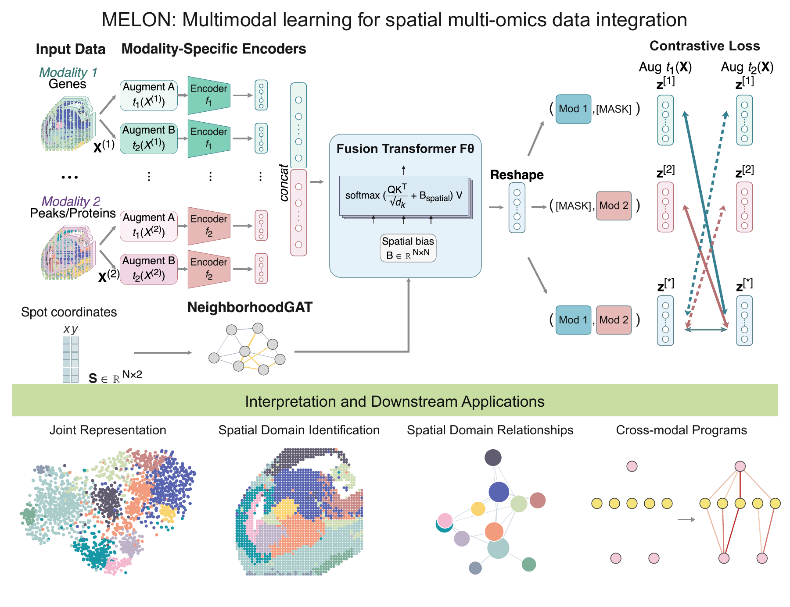

# MELON

MELON (Multi-modal lEarning framework for spatial muLti-Omics integratioN) is a multimodal learning framework for spatial multi-omics data integration. It encodes each modality separately and combines their representations through a fusion transformer with a learned spatial neighborhood bias. A contrastive objective compares modality-masked views with joint observations to preserve modality-specific and cross-modal synergistic information. MELON produces a joint representation for each spatial spot, supporting spatial domain identification and downstream biological analysis.

## Reproduce

The [`code/`](code/) directory contains scripts for reproducing MELON's joint embeddings and spatial clustering results.

## Usage and installation

Please follow the [Tutorials](https://txbrook.github.io/MELON_website/tutorials/) for usage and the [installation guide](code/melon_pkg/README.md#install) for setup.

## Citation

Yuchen Zhang, Lisa Huang, Jian Gao, Yuying Xie, Yu Shen, Liuqing Yang, Chunru Lin, and Lulu Shang. “MELON: A Cross Modality Information Aware and Spatial Aware Multimodal Learning Framework for spatial multi-omics data integration.” Manuscript (2026).
