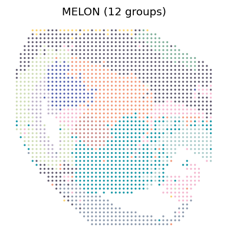
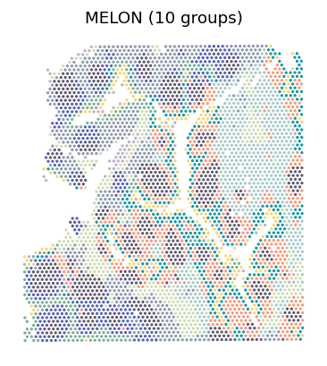
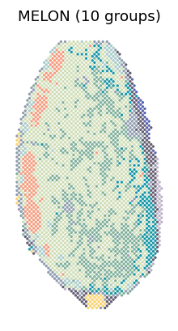
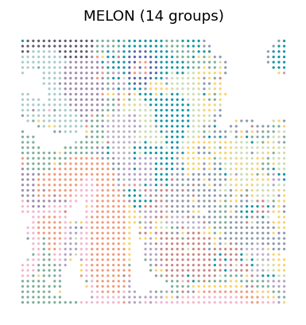
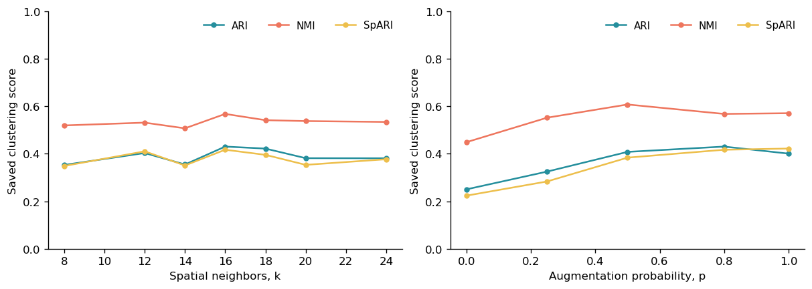
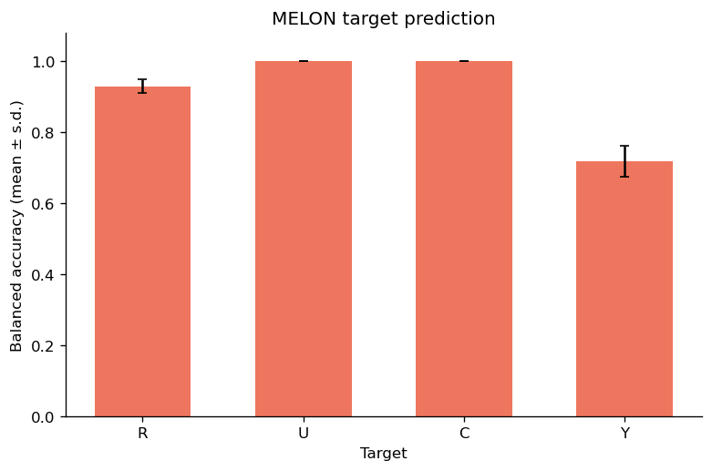

# Reproduce

Follow the saved MELON results through short explanations, reading code and displayed plots. The notebooks use existing embeddings, partitions and evaluation tables.

**Data:** `Published_Data_non_NASH` will be available through sharedoc; the link will be added after upload. Place the extracted folder beside `Reproduce/`, or set `MELON_PUBLISHED_DATA` to its location. Notebook outputs are included for reading on GitHub.

| Analysis | Related panels | Notebook |
| --- | --- | --- |
| Mouse E15.5 brain | Fig. 2a | [Read the workflow](clustering/paper_figures.ipynb) |
| Human tonsil | Fig. 3a | [Read the workflow](human_tonsil/paper_figures.ipynb) |
| Five-modality mouse brain | Fig. 3f-g | [Read the workflow](mouse_brain/paper_figures.ipynb) |
| Human lymph node | Fig. 4a; Supplementary Fig. 7e | [Read the workflow](human_lymph_node/paper_figures.ipynb) |
| Mouse E13 embryo | Fig. 4d; Supplementary Fig. 8e | [Read the workflow](mouse_e13_embryo/paper_figures.ipynb) |
| MELON robustness | Fig. 5a-b and archived ablations | [Read the workflow](robustness/paper_figures.ipynb) |
| MELON controlled simulation | Supplementary Fig. 10 | [Read the workflow](controlled_simulation/paper_figures.ipynb) |

## Mouse E15.5 brain

[Open the notebook](clustering/paper_figures.ipynb). Reads the saved MELON embedding and places its 12-domain partition on the tissue.

## Human tonsil

[Open the notebook](human_tonsil/paper_figures.ipynb). Shows the saved MELON spatial partition and MELON modality ablations.

## Five-modality mouse brain

[Open the notebook](mouse_brain/paper_figures.ipynb). Follows the saved MELON inputs and embedding to its 17-domain partition and UMAP.

## Human lymph node

[Open the notebook](human_lymph_node/paper_figures.ipynb). Shows the saved MELON spatial partition and t-SNE.

## Mouse E13 embryo

[Open the notebook](mouse_e13_embryo/paper_figures.ipynb). Shows the saved MELON spatial partition and t-SNE, with the separate MELON cis-pair input branch.

## MELON robustness

[Open the notebook](robustness/paper_figures.ipynb). Reads the saved MELON sensitivity and component-ablation scores.

## MELON controlled simulation

[Open the notebook](controlled_simulation/paper_figures.ipynb). Displays the stored MELON target-prediction scores and MELON ablation summaries.

Source files and any additional downstream inputs are listed in [figure sources](FIGURE_SOURCES.md).

## Training and clustering

Dataset directories retain their scripts for preprocessed, barcode-aligned input. Parameters are in [PARAMETERS.md](PARAMETERS.md).

Please follow the [Tutorials](https://txbrook.github.io/MELON_website/tutorials/) for installation and usage. Plotting dependencies are listed in [requirements.txt](requirements.txt).
