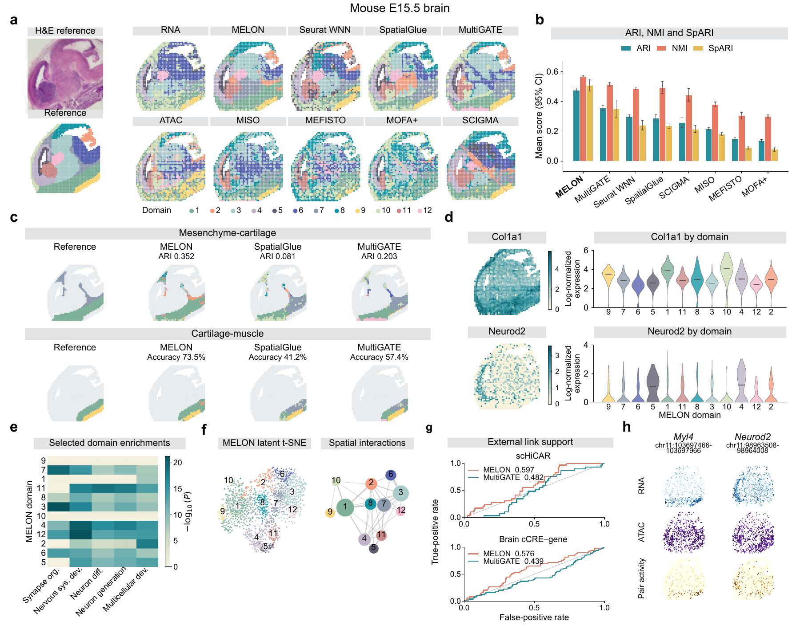
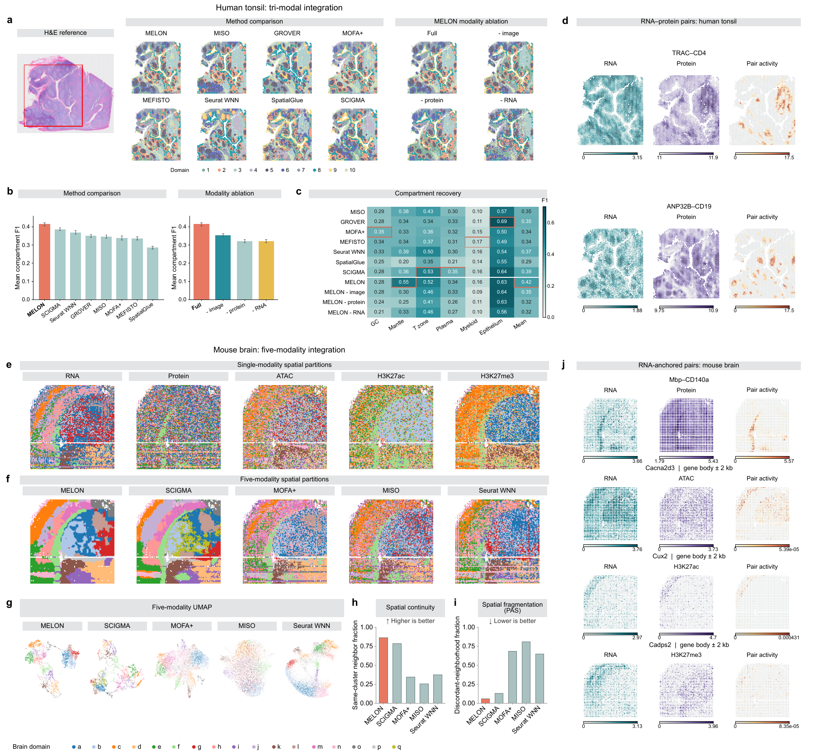
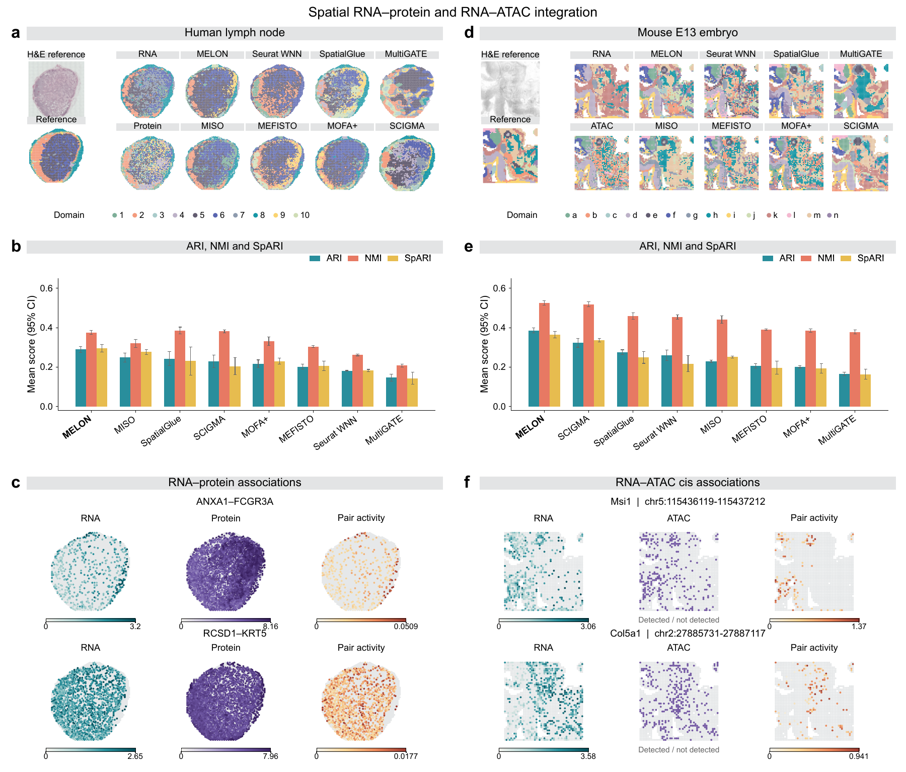
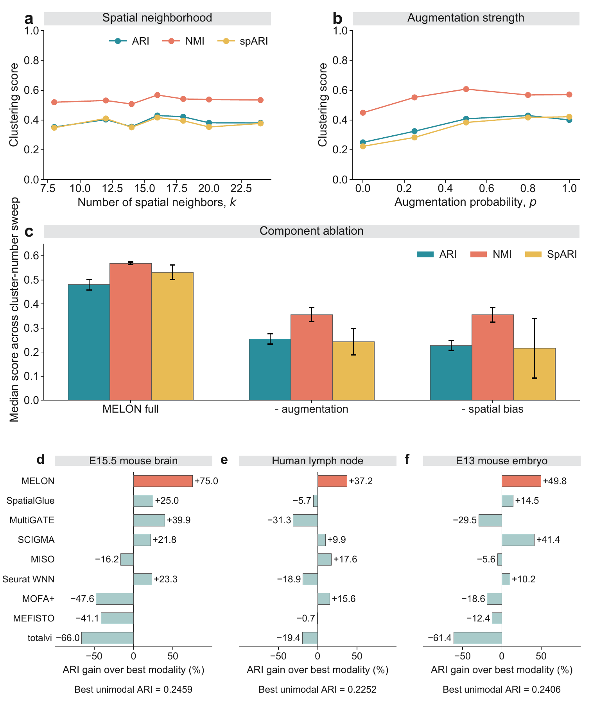

# Reproduce

Follow the saved data through the code to the corresponding paper figures. Each notebook interleaves a short explanation, the code that reads the archived results, and its displayed output. Saved embeddings, partitions and projection coordinates are used directly.

**Data:** `Published_Data_non_NASH` will be available through sharedoc; the download link will be added after upload. Place the extracted folder beside `Reproduce/`, or set `MELON_PUBLISHED_DATA` to its location. The notebooks already include their figure outputs for reading on GitHub.

| Analysis | Paper figures | Notebook |
| --- | --- | --- |
| Mouse E15.5 brain | Fig. 2 | [Read the workflow](clustering/paper_figures.ipynb) |
| Human tonsil | Fig. 3a-d | [Read the workflow](human_tonsil/paper_figures.ipynb) |
| Five-modality mouse brain | Fig. 3e-j | [Read the workflow](mouse_brain/paper_figures.ipynb) |
| Human lymph node | Fig. 4a-c, Supplementary Fig. 7e | [Read the workflow](human_lymph_node/paper_figures.ipynb) |
| Mouse E13 embryo | Fig. 4d-f, Supplementary Fig. 8e | [Read the workflow](mouse_e13_embryo/paper_figures.ipynb) |
| Sensitivity and ablation | Fig. 5 | [Read the workflow](robustness/paper_figures.ipynb) |
| Controlled simulation | Supplementary Fig. 10 | [Read the workflow](controlled_simulation/paper_figures.ipynb) |

## Mouse E15.5 brain — Fig. 2

The [notebook](clustering/paper_figures.ipynb) aligns `03_embeddings/MELON.csv` with `04_clusters/final_clusters.csv` by barcode, then places the saved labels on the tissue. The original figure shows how these spatial results connect to downstream expression, enrichment and molecular-pair analyses.

## Human tonsil and five-modality mouse brain — Fig. 3

The [tonsil notebook](human_tonsil/paper_figures.ipynb) reads the final partitions and saved color mappings for method comparisons and modality ablations. The [mouse-brain notebook](mouse_brain/paper_figures.ipynb) follows the saved modality inputs, native embedding, final labels and UMAP coordinates.

## Human lymph node and mouse E13 embryo — Fig. 4

The [lymph-node notebook](human_lymph_node/paper_figures.ipynb) and [E13 notebook](mouse_e13_embryo/paper_figures.ipynb) show the main spatial partitions and separately stored supplementary t-SNE results. E13 also identifies the distinct MACS3/decoder branch used for the cis-pair analysis.

## Robustness — Fig. 5

The [robustness notebook](robustness/paper_figures.ipynb) reads the existing neighborhood, augmentation and ablation score tables from `05_Fig5_robustness/`, then displays the saved curves and summaries.

## Controlled simulation — Supplementary Fig. 10

The [simulation notebook](controlled_simulation/paper_figures.ipynb) displays saved R/U/C/Y targets, follows the three input/embedding snapshots, and plots the stored probe-evaluation results.

The manuscript previews retain the supplied figure artwork. Each notebook lists the files for its panels and identifies downstream score or pair-activity tables stored outside this archive. See [figure sources](FIGURE_SOURCES.md) for the full mapping.

## Training and clustering

Dataset directories retain their scripts for preprocessed, barcode-aligned input. These are separate from the saved-result notebooks above. Parameters and their sources are in [PARAMETERS.md](PARAMETERS.md).

Please follow the [Tutorials](https://txbrook.github.io/MELON_website/tutorials/) for installation and usage. Plotting dependencies are listed in [requirements.txt](requirements.txt).
