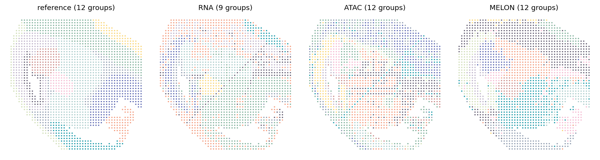

# Spatial clustering

## Paper figures

Open [paper_figures.ipynb](paper_figures.ipynb) to follow the saved results into Fig. 2. The notebook places the explanation, reading code and figure output together.



## Run from preprocessed data

These scripts train MELON on paired molecular profiles and spatial coordinates, then cluster the learned joint embedding.

## Installation

From the repository root, install MELON in an activated Python environment.

```bash
python -m pip install -e .
```

For `.h5ad` inputs, use `python -m pip install -e '.[h5ad]'`. See the [Tutorials](https://txbrook.github.io/MELON_website/tutorials/) for data preparation and analysis details.

## Mouse E15.5 brain RNA–ATAC analysis

The [`mouse_E15_brain/`](mouse_E15_brain/) directory contains `mRNA_data.h5` and `ATAC_data.h5`. Prepare a barcode-matched `coords.csv` with the spot barcodes as its index and columns `x` and `y`. Processed data and spatial information are available from [MISAR-seq](https://github.com/gpenglab/MISAR-seq).

From the repository root, run the workflow with a directory containing all three files.

```bash
bash Reproduce/clustering/run_mouse_e15.sh /path/to/mouse_E15_brain
```

The workflow applies TF-IDF and LSI to ATAC, trains for 100 epochs with seed 42, and clusters the embedding with a target of 12 clusters using spectral clustering, Gaussian mixtures, k-means, Walktrap, Louvain, and Leiden. Leiden supplies the primary cluster assignments.

Outputs are written to `Reproduce/clustering/results/mouse_e15/`, including `latent_melon.csv`, `clusters_k12.csv`, and separate cluster assignments for each method.

## Individual analysis steps

Run training and clustering separately to select your own inputs and settings.

```bash
melon-run --help
melon-cluster --help
```

The [`run_melon.py`](run_melon.py) and [`cluster_melon.py`](cluster_melon.py) scripts provide the same command-line interfaces.
