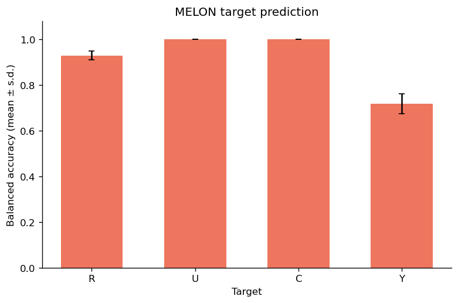

# Controlled simulation

## Analysis workflow

[Open the notebook](analysis.ipynb). Edit parameters directly in its configuration cell.

Data: `Published_Data_non_NASH/06_Controlled_simulation/`, seeds 123, 124 and 125. The sharedoc download link will be added after upload.
