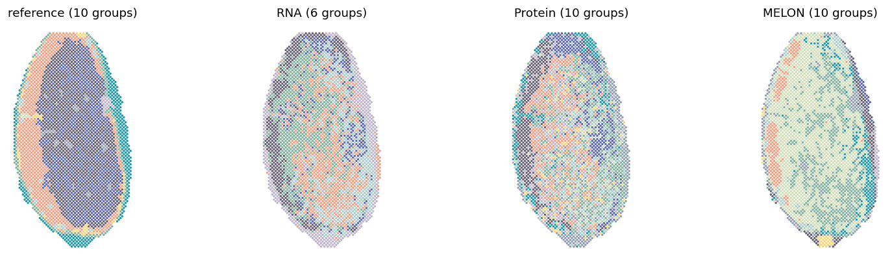

# Human lymph node

## Paper figures

Open [paper_figures.ipynb](paper_figures.ipynb) to follow the saved results into Fig. 4a-c. The notebook places the explanation, reading code and figure output together.



## Run from preprocessed data

Input: 3,484 aligned spots in `features.npz`, with `barcodes`, `coords`, `RNA` (normalized log-expression), and `Protein` (CLR-transformed ADT features). Both modalities must already be preprocessed.

Train for 100 epochs with batch size 2,048. Clustering evaluates 6, 8, 10, 12, and 14 clusters; the main spatial partition uses 10. Run from the repository root:

```bash
python Reproduce/human_lymph_node/run.py --features data/lymph_node/features.npz --out results/lymph_node
python Reproduce/human_lymph_node/cluster.py --embedding results/lymph_node/embedding.csv --coords results/lymph_node/coords.csv --out results/lymph_node/clustering
```

Add `--truth data/lymph_node/truth.csv` for ARI/NMI evaluation (CSV columns: `barcode,label`), and `--umap` for UMAP coordinates. Parameters are in [settings.json](settings.json).
