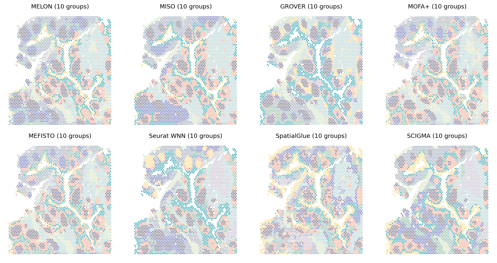

# Human tonsil

## Paper figures

Open [paper_figures.ipynb](paper_figures.ipynb) to follow the saved results into Fig. 3a-d. The notebook places the explanation, reading code and figure output together.



## Run from preprocessed data

Input: 4,194 aligned spots in `features.npz`, with `barcodes`, `coords`, `RNA` (normalized log-expression), `Protein` (CLR features), and `Image` (2,048 frozen InceptionV3 features). All features must already be preprocessed.

Train for 100 epochs with batch size 2,048, then cluster the native 128-dimensional embedding with k-means (10 clusters, 20 initializations). Run from the repository root:

```bash
python Reproduce/human_tonsil/run.py --features data/tonsil/features.npz --out results/tonsil
python Reproduce/human_tonsil/cluster.py --embedding results/tonsil/embedding.csv --coords results/tonsil/coords.csv --out results/tonsil/clustering --umap
```

For modality ablations, add `--omit RNA`, `--omit Protein`, or `--omit Image` to training and use a separate output directory. Training parameters are in [settings.json](settings.json).
