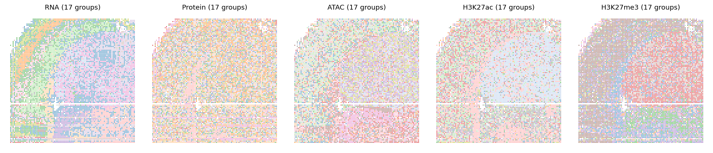

# Five-modality mouse brain

## Paper figures

Open [paper_figures.ipynb](paper_figures.ipynb) to follow the saved results into Fig. 3e-j. The notebook places the explanation, reading code and figure output together.



## Run from preprocessed data

Input: 9,567 aligned spots in `features.npz`, with `barcodes`, `coords`, and five preprocessed 30-dimensional matrices: `RNA`, `Protein`, `ATAC`, `H3K27ac`, and `H3K27me3`. RNA and protein are PCA features; the three chromatin inputs are ArchR LSI features.

Train for 10 epochs with batch size 2,048 and seed 2025. Export uses 14 spatial neighbors. Clustering follows the paper's PCA20 → row L2 → 15-neighbor graph → Leiden workflow. Run from the repository root:

```bash
python Reproduce/mouse_brain/run.py --features data/mouse_brain/features.npz --out results/mouse_brain
python Reproduce/mouse_brain/cluster.py --embedding results/mouse_brain/embedding.csv --coords results/mouse_brain/coords.csv --out results/mouse_brain/clustering --umap
```

To export an existing model, add `--checkpoint path/to/MELON_10epochs.ckpt`. The saved paper resolution yields 17 clusters for the archived embedding; the observed count and spatial continuity metrics are saved for each run. Parameters are in [settings.json](settings.json).
