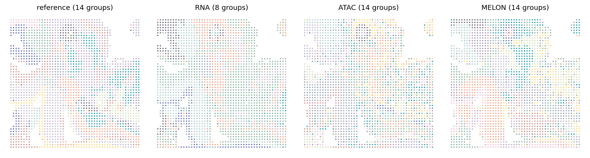

# Mouse E13 embryo

## Paper figures

Open [paper_figures.ipynb](paper_figures.ipynb) to follow the saved results into Fig. 4d-f. The notebook places the explanation, reading code and figure output together.



## Run from preprocessed data

Input: 2,187 aligned spots in `features.npz`, with `barcodes`, `coords`, `RNA` (normalized log-expression), and `ATAC` (50-dimensional TF-IDF/LSI features). Both modalities must already be preprocessed.

Train for 100 epochs with batch size 2,048. Clustering evaluates 10, 12, 14, 16, and 18 clusters; the main spatial partition uses 14. Run from the repository root:

```bash
python Reproduce/mouse_e13_embryo/run.py --features data/e13/features.npz --out results/e13
python Reproduce/mouse_e13_embryo/cluster.py --embedding results/e13/embedding.csv --coords results/e13/coords.csv --out results/e13/clustering
```

Add `--truth data/e13/truth.csv` for ARI/NMI evaluation (CSV columns: `barcode,label`), and `--umap` for UMAP coordinates. Parameters are in [settings.json](settings.json).
