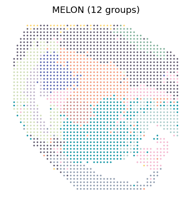

# Mouse E15.5 brain

## Results

Open the [analysis notebook](paper_figures.ipynb) to follow the saved MELON embedding and its 12-domain spatial partition through explanations, code and plots.



## Run the analysis

The [`mouse_E15_brain/`](mouse_E15_brain/) directory contains `mRNA_data.h5` and `ATAC_data.h5`. Provide a barcode-matched `coords.csv` with spot barcodes as its index and columns `x` and `y`. Processed data and spatial information are available from [MISAR-seq](https://github.com/gpenglab/MISAR-seq).

Run from the repository root with a directory containing all three files:

```bash
bash Reproduce/mouse_e15_brain/run_mouse_e15.sh /path/to/mouse_E15_brain
```

The workflow applies TF-IDF and LSI to ATAC, trains MELON for 100 epochs with seed 42, and clusters the embedding with a target of 12 domains. Leiden supplies the primary assignments. Outputs are written to `Reproduce/mouse_e15_brain/results/mouse_e15/`, including `latent_melon.csv`, `clusters_k12.csv`, and the individual clustering results.

The [`run_melon.py`](run_melon.py) and [`cluster_melon.py`](cluster_melon.py) scripts also support separate training and clustering. Please follow the [Tutorials](https://txbrook.github.io/MELON_website/tutorials/) for installation and usage.
