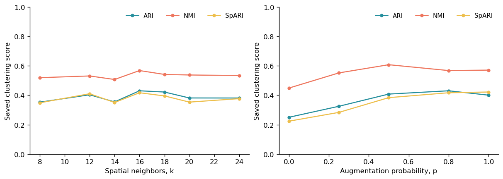

# Robustness

## Results

Open the [analysis notebook](paper_figures.ipynb) to inspect MELON neighborhood and augmentation sensitivity, followed by the archived component-ablation sweep.

Data: `Published_Data_non_NASH/01_Mouse_E15_5/05_Fig5_robustness/`. The sharedoc download link will be added after upload.

Ablation bars summarize the saved sweep across six cluster counts, with medians and interquartile ranges.
